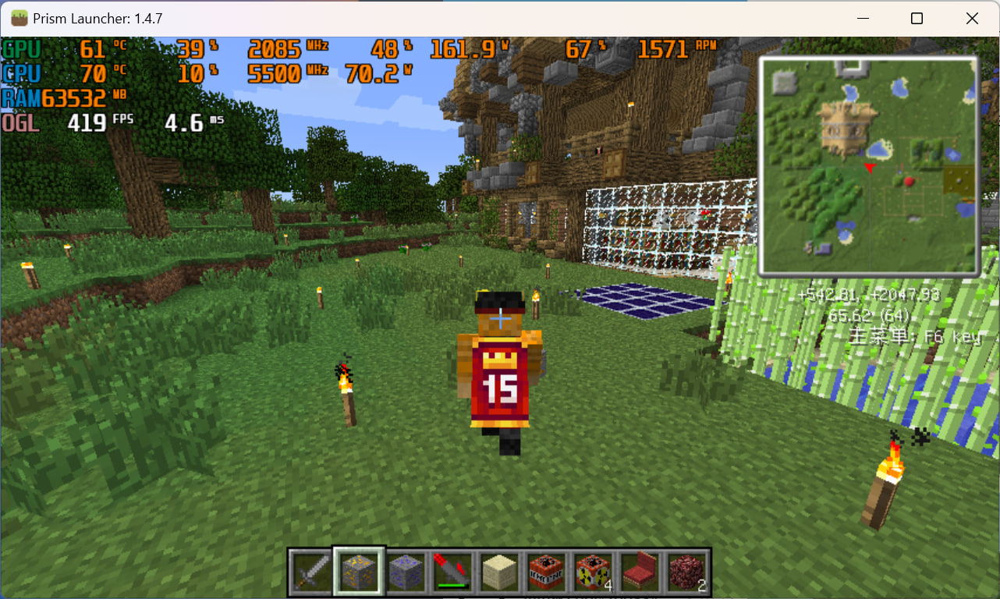

# The Story of SkinMeAgain

中文版请见[这里](https://github.com/CatMe0w/SkinMeAgain/blob/master/README_zh.md)。

### **Bringing Back the Lost Minecraft Skins**

I have a Minecraft 1.4.7 server that has been quietly running for years. Its modpack dates back to 2012, with the SkinMe mod built in—an alternative skin service that was popular at the time.

SkinMe had been shut down for a long time, and Mojang's skin API for older versions had also been discontinued years ago. Everyone on the server had turned back into the default Steve. I always knew that.

One day, when I happened to glance at the game log, I noticed that the SkinMe mod was still trying to connect to some non-existent domain names.

As far as I could remember, nobody had ever mentioned anything about fallback servers, but I had a feeling there was something undiscovered here.

I decompiled the SkinMe mod and found a (maybe) hidden fallback server list, hardcoded in the code.

These servers were meant to pull skin data from other platforms when both SkinMe and Mojang went offline, keeping skins alive.

Two of them had expired.

I registered both domains and wrote the code you see here. The fallback order comes from [CustomSkinLoader](https://modrinth.com/mod/customskinloader) (Mojang -> LittleSkin -> Blessing Skin -> ElyBy -> TLauncher), so the SkinMe mod now follows CustomSkinLoader's current logic to fetch skins.

From 2024-12-03 or 2024-12-04 (depending on where you are), all Minecraft 1.3.x through 1.5.x players with the SkinMe mod installed will find their skins showing up again, with no configuration changes needed.



## Run

Requires Deno.

```sh
deno run --allow-net skinmeagain.js
```

## License

MIT License
